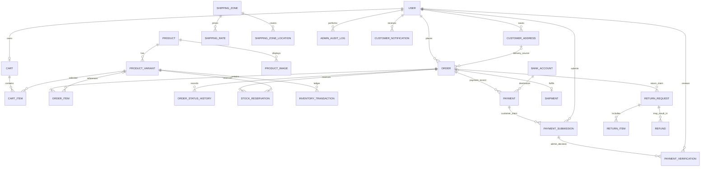

# CroppTech Commerce Store — Database Schema Proposal

**Status:** Design and implementation reference. The Prisma schema and two initial migrations have been applied to the Neon development branch. This document does not mean checkout or production is enabled.

## 1. Confirmed business rules

- Store launch is Nigeria-only. All orders, delivery fees, payment instructions and payments are in NGN.
- Browsing, viewing product details and adding to/editing a cart are public. Authentication is required only when a customer proceeds from the cart to checkout.
- Guest carts remain in the browser. Signed-in carts are stored in the database; on sign-in, merge the guest cart into the account cart using the full product-variant identity and add quantities for matching lines.
- The only launch payment method is manual bank transfer.
- A customer payment submission is a claim, not proof of payment. Only an authorized admin who verifies the actual bank transaction can mark an order paid.
- Delivery fees are selected from configurable Nigerian delivery zones and are snapshotted on the order.
- Customers submit return/refund requests; an admin reviews and decides.
- Product images are public Cloudinary assets. Payment receipts must use private storage, never the public product-image folder.
- The Sterling Bank details currently supplied are temporary and must be configurable, not hard-coded. Replace them with the official company account when available.

## 2. Entity relationship diagram

## 3. Proposed tables and responsibilities

### Identity and customer data
| Table | Purpose | Important fields |
|---|---|---|
| `users` | Local application profile linked to the managed auth provider | id, auth_provider, auth_subject (unique), email (unique), full_name, role, is_active, created_at |
| `customer_addresses` | Saved Nigerian delivery addresses | user_id, recipient_name, phone, state, city, locality, street_address, landmark, postal_code, is_default |

The authentication provider owns passwords, sessions, email verification and password reset. Do not create duplicate password/session/token tables. The app's `users` record stores the provider's stable subject ID. Enforce roles on the server, not in client-side UI alone.

### Catalogue and inventory
| Table | Purpose | Important fields |
|---|---|---|
| `products` | Product catalogue | name, slug (unique), description, category, status, base_price (optional), created_at |
| `product_variants` | Sellable size/colour combination | product_id, sku (unique), size, colour, price, stock_quantity, is_active |
| `product_images` | Product image metadata | product_id, cloudinary_public_id, secure_url, alt_text, image_role, sort_order, width, height |

Use a variant for every actual sellable size/colour combination. A product must not be purchasable until its real price, variant options, stock and approved product imagery are configured. Do not seed invented inventory or treat Pexels inspiration photos as approved product photography.

### Cart and orders
| Table | Purpose | Important fields |
|---|---|---|
| `carts` | One persistent cart per signed-in user | user_id (unique), updated_at |
| `cart_items` | Selected variant and quantity | cart_id, variant_id, quantity; unique(cart_id, variant_id) |
| `orders` | Immutable checkout totals and delivery snapshot | order_number (unique), customer_id, status, payment_status, currency='NGN', subtotal, delivery_fee, total, delivery snapshot, placed_at |
| `order_items` | Purchase-time product snapshot | order_id, product_id (nullable), variant_id (nullable), product_name, sku, size, colour, quantity, unit_price, line_total |
| `order_status_history` | Auditable order timeline | order_id, old_status, new_status, changed_by, note, created_at |

Order items snapshot product and variant details so later catalogue edits or archival cannot rewrite purchase history. Snapshot the recipient, phone and full delivery address on the order; edits to a saved address must not change an existing order.

### Payment and bank-transfer verification
| Table | Purpose | Important fields |
|---|---|---|
| `bank_accounts` | Admin-configurable transfer destination | bank_name, account_name, account_number_encrypted, currency, is_active |
| `payments` | Payment obligation for an order | order_id, bank_account_id, amount_due, currency, status |
| `payment_submissions` | Customer's transfer claim | payment_id, submitted_by, amount_claimed, sender_account_name, sender_bank, transaction_reference, receipt_storage_provider, receipt_storage_key, status, submitted_at |
| `payment_verifications` | Admin decision and evidence | submission_id, reviewed_by, decision, note, verified_transaction_reference, created_at |
| `refunds` | Refund decision and execution record | payment_id, return_request_id (optional), amount, status, reason, reviewed_by, processed_at |

Keep account details out of source code and ordinary public settings. Encrypt the bank account number before storing it in `account_number_encrypted`; never persist plaintext account numbers. Restrict decryption to authorized server-side payment-instruction/admin workflows. Snapshot the encrypted account number on each payment record. A receipt is supporting evidence only. The customer submission must never update payment status to paid. An admin verification transaction should atomically approve the submission, mark the payment paid, update the order payment status, write order history and audit the action.

### Delivery, returns and operations
| Table | Purpose | Important fields |
|---|---|---|
| `shipping_zones` | Named configurable delivery zones | name, is_active |
| `shipping_zone_locations` | Nigerian state/city/locality coverage | zone_id, state, city, locality |
| `shipping_rates` | Fee and delivery estimate by zone | zone_id, fee, min_days, max_days, is_active |
| `shipments` | Fulfilment and tracking; supports multiple parcels for one order | order_id, carrier, tracking_number, tracking_url, status, shipped_at, delivered_at |
| `return_requests` | Customer return/refund request | order_id, reason, customer_note, status, admin_note, reviewed_by |
| `return_items` | Items and quantities in a return | return_request_id, order_item_id, quantity, condition_note |
| `stock_reservations` | Temporary stock held for unpaid orders | order_id, variant_id, quantity, expires_at, released_at |
| `inventory_transactions` | Stock movement ledger | variant_id, type, quantity_delta, reference_type, reference_id, performed_by |
| `admin_audit_logs` | Sensitive admin action history | actor_id, action, entity_type, entity_id, metadata, created_at |
| `customer_notifications` | Delivery status of customer notifications | user_id, order_id, channel, template, status, sent_at |

Shipping fee and delivery estimate are copied to the order at checkout. Zone coverage and rates can change later without altering historical orders. Reserve stock atomically at checkout; release reservations on expiry/cancellation and convert the reservation into a sale movement after payment approval. The proposed 24-hour payment expiry is not yet confirmed and must remain configurable. A return request can be associated with multiple refund records, each linked to its payment. An order may have multiple shipment records when fulfilled in separate parcels.

## 4. Status separation

**Order status:** `awaiting_payment`, `payment_under_review`, `confirmed`, `processing`, `shipped`, `delivered`, `cancelled`, `expired`.

**Payment status:** `unpaid`, `submitted`, `under_review`, `paid`, `rejected`, `expired`, `partially_refunded`, `refunded`.

**Payment submission status:** `pending`, `needs_clarification`, `approved`, `rejected`.

**Return request status:** `submitted`, `under_review`, `approved`, `rejected`, `completed`.

These are separate because an order can be awaiting fulfilment after payment is verified, or have a payment submission under review while the order remains unpaid.

## 5. Important database rules

1. Use PostgreSQL `NUMERIC(12,2)` for prices, fees and money; never floating-point types.
2. Store timestamps as timezone-aware values (UTC in the database).
3. Use foreign keys, unique constraints and check constraints for positive quantities, non-negative prices/fees and valid references.
4. Add indexes for product slug/status/category, variant SKU, user email/auth subject, order number/customer/status/created_at, payment transaction reference, and foreign keys used in order/admin views.
5. Recalculate prices, delivery fees, discounts (if later introduced), totals and stock on the server. Never trust client-supplied totals.
6. Use database transactions and row-level locking/conditional updates for stock reservation and payment verification to prevent overselling or duplicate approval.
7. Enforce customer ownership on every cart, order, address, payment-submission and return endpoint.
8. Only authorized admin roles may edit stock, bank details, shipping rates, payment decisions, refunds or order fulfilment.
9. Archive/deactivate products and variants instead of deleting records referenced by order history.
10. Keep receipt objects in private storage. Store only the provider name and opaque storage key (`receipt_storage_provider`, `receipt_storage_key`); do not store public receipt URLs. Validate file size/type, use randomized object keys and short-lived signed access, and authorize every receipt download.
11. Do not store card details or bank login credentials.
12. Log admin changes to bank accounts, stock, payment decisions, refunds, delivery fees and roles.

## 6. Checkout and cart lifecycle

1. Visitor browses and adds variants to a local guest cart without signing in.
2. Visitor can open and edit the cart without signing in.
3. On **Proceed to checkout**, redirect signed-out visitors to sign in/create an account.
4. After authentication, merge the guest cart into the signed-in cart; combine matching variant lines and validate active variants.
5. Customer selects/adds a Nigerian delivery address.
6. Server loads current product/variant prices, verifies active status and stock, resolves the delivery zone/rate, then calculates NGN totals.
7. In one database transaction, create the order and item snapshots, create stock reservations, create payment obligation and clear the persistent cart.
8. Show the configured bank-transfer instructions and exact order reference/amount.
9. Customer submits transfer details and a private receipt. Payment remains submitted/under review.
10. Admin checks the actual bank transaction and approves/rejects/requests clarification. Approval updates payment/order history atomically.
11. Admin fulfils the order and adds shipment/tracking information. Customer sees order status and notifications.

## 7. Implementation/migration plan

1. Confirm the remaining business decisions below and select the managed auth, email and private receipt-storage providers.
2. Add Prisma and create the schema/enums with PostgreSQL mappings, indexes, constraints and deletion rules.
3. Provision a **new dedicated CroppTech Neon database** through the Vercel-managed Neon integration or an independently authorized Neon organization. Do not reuse another project's database.
4. Add environment variables only in local environment files and Vercel project settings; never commit secrets.
5. Run schema validation and generate Prisma Client locally; review migration SQL.
6. Apply the initial migration to a fresh development database only; inspect the resulting tables and constraints.
7. Add admin-configurable store settings, bank account configuration and shipping zones without inventing stock/product data.
8. Build auth/cart/checkout/payment/admin workflows in stages; test ownership, concurrent stock reservation, duplicate payment submission and admin authorization.
9. Only import products after actual images, prices, sizes, colours, SKUs and stock quantities are approved.
10. Test end-to-end in staging before enabling production checkout.

**Development database:** The initial schema and payment-audit hardening migrations have been applied to the development branch. Production remains untouched; the next schema changes must be validated and migrated in development first.

## 8. Decisions still needed

- Authentication provider: Clerk is a candidate, not yet selected.
- Email provider for verification, order and delivery notifications.
- Private receipt storage provider and retention period.\n- Encryption key-management approach for bank account numbers (managed secret/KMS key; never commit keys).
- Delivery zones, covered Nigerian locations, rates and delivery estimates.
- Payment expiry window (24 hours was suggested, not confirmed).
- Return eligibility window, item condition rules and exchange/refund policy.
- Co-ord set sizing: one shared set size, or independent top and bottom sizes.
- Confirmed product SKUs, sizes, colours, prices and stock counts.
- Approved product photography.
- Initial admin/owner email addresses and staff roles.

## 9. Scope boundary

This document records the current schema design and implementation decisions. It does not mean authentication is integrated, checkout is active, receipt uploads are configured, or any product is ready for sale. Those features should be implemented in separate reviewed steps after the open decisions are resolved.
